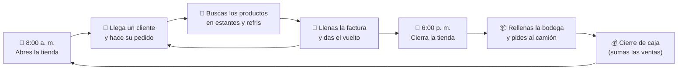

[README.md](https://github.com/user-attachments/files/35375989/README.md)
<div align="center">


# 🏪 La Pulpería

### *Abre tu propia pulpería… y aprende matemáticas sin darte cuenta.*

Un juego educativo en pixel art para niños y niñas de **8 a 10 años**: atiendes clientes,
llenas la factura **con tu cabeza**, das el vuelto y cierras la caja al final del día.


[🎮 Cómo jugar](#-cómo-jugar) ·
[🧮 Qué se aprende](#-qué-se-aprende) ·
[📊 Para profes y papás](#-para-profes-y-papás) ·
[🚀 Instalación](#-instalación) ·
[🧰 Por dentro](#-por-dentro)

</div>

---

## 🌅 Son las 8:00 a. m. y la pulpería abre

Doña Rosa, la dueña de toda la vida, te deja las llaves:
*"Desde hoy cuidas mi pulpería."*

Entra el primer cliente:

> 🧑‍🚀 **Astronauta Leo:** ¡Buenos días! Quiero hacer pan, ¿me ayudas?
> 🧑 **Tú:** ¡Claro! Necesitas 6 huevos y 3 bolsas de harina.
> 🧑‍🚀 **Astronauta Leo:** ¡Perfecto! Entonces quiero **un tercio** de pan.

¿Un tercio de 6 huevos y de 3 bolsas de harina? 🤔

Vas a los estantes, pones en el mostrador lo que te pidió y abres la factura.
Ahí no hay trampa: **la calculadora cuesta dinero**. 2 manzanas a ₡3 cada una, más 2 bananos a ₡1, más…

Así pasa el día hasta las 6:00 p. m. Después queda tiempo para rellenar la bodega y hacer el **cierre de caja**.

---

## 📸 Un vistazo

<table>
  <tr>
    <td align="center"><br><b>El menú</b>: la misma pulpería del juego</td>
    <td align="center"><br><b>La tienda</b>: clientes, estantes, refris y mostrador</td>
  </tr>
  <tr>
    <td align="center"><br><b>La factura</b>: cantidad × precio, a puro cálculo mental</td>
    <td align="center"><br><b>El recetario</b>: qué lleva cada receta (sin dar las respuestas)</td>
  </tr>
  <tr>
    <td align="center"><br><b>El reporte</b>: el progreso, listo para el profe</td>
    <td align="center"><br><b>Filtro ESPACIAL</b>: la misma tienda, otro ambiente</td>
  </tr>
</table>

---

## 🎮 Cómo jugar



### 🕹️ Controles

| Tecla | Qué hace |
|---|---|
| <kbd>←</kbd> <kbd>↑</kbd> <kbd>→</kbd> <kbd>↓</kbd> / <kbd>W</kbd> <kbd>A</kbd> <kbd>S</kbd> <kbd>D</kbd> | Caminar |
| <kbd>E</kbd> | Usar lo que tienes enfrente: estantes, caja, teléfono, bodega, Tavo… |
| <kbd>P</kbd> | El cliente repite su pedido |
| <kbd>R</kbd> | Abrir el libro de recetas |
| <kbd>C</kbd> | Comprar la calculadora en la factura (cuesta ₡5, ₡10 o ₡15) |
| <kbd>Shift</kbd> + <kbd>E</kbd> | Mover el mostrador (la fila de clientes lo sigue) |
| <kbd>Tab</kbd> | Saltar el tutorial |
| <kbd>Esc</kbd> | Pausa |
| <kbd>F11</kbd> | Pantalla completa |

### 🗺️ Dos formas de jugar

| 📖 **Modo historia** | 🎈 **Modo libre** |
|---|---|
| Doña Rosa te guía día a día: te saluda, te pone una **meta diaria** y se despide con tu nombre. | Sin guion: abres la tienda y juegas a tu ritmo. |
| La dificultad sube sola en los **días 8 y 16**. | La dificultad la escoges en OPCIONES. |
| Cada modo tiene **su propia partida guardada**: jugar uno no toca el otro. | ✔️ Lo mismo aquí. |

---

## 🧮 Qué se aprende

Cada habilidad se puede encender o apagar en **OPCIONES › MODO DE JUEGO**, según lo que se esté practicando en clase:

| | Opción | Habilidad | En el juego |
|---|---|---|---|
| 🧾 | Factura | Multiplicación y suma | Cantidad × precio, subtotales y total |
| 🔢 | Contar en la factura | Conteo | La factura muestra dibujos en vez de números |
| 🍰 | Fracciones de recetas | Fracciones | "Quiero **la mitad**… **un tercio**… **un cuarto** de la receta" |
| ✖️ | Multiplicar recetas | Multiplicación | "Quiero el **doble** de gallo pinto" |
| 💵 | Vuelto en la factura | Resta | El cliente paga con billetes y tú das el vuelto |
| ➕ | Suma del cierre de caja | Suma de varias cantidades | Al final del día sumas todas las ventas |
| 🧠 | Recordar el pedido | Memoria de trabajo | El pedido se esconde a los pocos segundos |
| 🎨 | Adivinanzas de colores | Razonamiento deductivo | "Una fruta que no es roja ni morada" |
| ⏳ | Paciencia de los clientes | Atender a tiempo | Si tardas mucho, el cliente se va |

> [!IMPORTANT]
> **Regla de oro del juego:** el niño o la niña calcula **mentalmente**.
> El recetario dice qué lleva cada receta, pero **nunca** la respuesta.
> La calculadora existe, pero **se paga** con el dinero de la tienda, así que usarla es una decisión.

Hay **3 niveles**: principiante 🌱, intermedio 🌿 y avanzado 🌳. Con cada nivel crecen la fila de clientes (2, 4 o 6 personas) y lo difícil de los pedidos.

---

## 📊 Para profes y papás

En **OPCIONES › EXTRAS › REPORTE DE PROGRESO** hay una tabla con el progreso de cada partida:

- ✅ **Aciertos** y ❌ **errores** de cada habilidad que esté activada.
- 📈 **Porcentaje de aciertos**, con una barrita de color: 🟩 70 % o más · 🟨 de 40 % a 69 % · 🟥 menos de 40 %.
- 🧮 Cuántas veces **se compró la calculadora**.
- 💾 Con <kbd>Enter</kbd> se guarda como **CSV**, que se abre directo en **Excel**.

El tutorial no cuenta, para no ensuciar los datos.

---

## ✨ Detalles que nos encantan

- 🪧 **Tu pulpería, tu nombre:** al empezar, el niño escribe el nombre del cartel (hasta 20 letras) y el letrero del techo se acomoda solo.
- 🐱🐶 **Canela y Bruno:** la gata y el perro de la tienda. Pasean, duermen y a veces Bruno persigue a Canela por los pasillos.
- 📞 **El teléfono rojo:** para pedirle mercadería al camión cuando la bodega se vacía.
- 🙋 **Tavo, el ayudante:** lo llamas con el botón de la pared y rellena los estantes por ti… pero cobra.
- 🎭 **Clientes disfrazados:** payasos, bomberas, chefs, astronautas y piratas, cada uno con su pedido.
- 📚 **8 recetas:** pan, queque, arroz con leche, gallo pinto, ensalada de frutas, vaca negra, banana split y licuado de banano.
- 👕 **Armario:** ropa para tu personaje y accesorios para Canela, comprados con lo que ganas.
- 🎵 **Música de marimba** y sonidos hechos por nosotros.
- 🌗 **Filtros de pantalla:** *Realista* (luz cálida de tarde) y *Espacial* (neón y estrellas).
- 💾 **Guardado automático:** se puede cerrar cuando sea; CONTINUAR sigue donde quedó.

---

## 🚀 Instalación

> Solo se necesita **Python 3.10 o más nuevo**.
> En Windows, al instalarlo, marca ✅ *"Add python.exe to PATH"*.

### La vía rápida ⚡

| Sistema | Qué hacer |
|---|---|
| 🪟 Windows | Doble clic en **`iniciar.bat`** |
| 🍎 Mac / 🐧 Linux | `./iniciar.sh` |

La primera vez crea un entorno e instala todo solo. Las siguientes veces abre directo.

### A mano 🛠️

```bash
git clone https://github.com/<usuario>/<repo>.git
cd <repo>
python -m venv .venv
# Windows:   .venv\Scripts\activate
# Mac/Linux: source .venv/bin/activate
pip install -r requirements.txt
python main.py
```

> [!WARNING]
> No instales `pygame` y `pygame-ce` juntos en el mismo entorno: chocan. Este juego usa **pygame-ce**.

---

## 🧰 Por dentro

Casi todo se **dibuja con código**: la tienda, los muebles, los clientes, el cartel y los adornos. Solo algunos productos usan imágenes de `imagenes/`. Los sonidos y la música se generaron con los scripts de `herramientas/`.

<details>
<summary><b>📁 Mapa del proyecto</b> (clic para abrir)</summary>

```text
📦 La Pulpería
├── main.py            🎬 el corazón: escenas, menús, factura, guardado
├── clientes.py        🧑 llegada, fila, pedidos y paciencia
├── historia.py        📖 Doña Rosa, metas y saludos del modo historia
├── horario.py         🕗 el reloj del día (8 a. m. a 8 p. m.)
├── niveles.py         🌱 principiante, intermedio y avanzado
├── modos.py           🧮 las habilidades que se encienden o apagan
├── recetas.py         🍰 recetas, mitades, tercios y cuartos
├── recetario.py       📚 el libro de recetas
├── factura.py         🧾 la factura
├── calculadora.py     🔢 la calculadora (de pago)
├── estadisticas.py    📊 aciertos y errores para el reporte
├── interior.py        🏪 la tienda por dentro
├── zonas.py           🗺️ la fachada, la calle y el cartel
├── bodega.py          📦 la bodega
├── camion.py          🚚 pedidos por teléfono
├── ayudante.py        🙋 Tavo, el ayudante
├── mascota.py         🐱 Canela
├── perro.py           🐶 Bruno
├── cosmeticos.py      👕 ropa y accesorios
├── filtros.py         🌗 filtros de pantalla
├── sonido.py          🎵 música y efectos
├── tutorial.py        🎓 el tutorial paso a paso
├── imagenes/          🖼️ algunos productos en pixel art
├── herramientas/      🛠️ generadores de música y sonidos
└── LEEME.md           📝 manual completo, opción por opción
```

</details>

<details>
<summary><b>💾 ¿Dónde se guarda la partida?</b></summary>

Junto al juego hay tres archivos:

- `partida_historia.json`: la partida del modo historia
- `partida_libre.json`: la partida del modo libre
- `ajustes.json`: las opciones, que sirven para los dos modos

Borrar uno empieza ese modo de cero. El `.gitignore` del repositorio ya los deja fuera, para no subir las partidas de nadie.

</details>

<details>
<summary><b>🤔 ¿Qué es una pulpería?</b></summary>

Es la tienda de barrio de Centroamérica: pequeña, de confianza, con un poco de todo, donde te conocen por tu nombre. Para muchos niños es el primer lugar donde manejan dinero de verdad. Por eso nos pareció el escenario perfecto para practicar matemáticas.

</details>

---

<div align="center">


**Hecho con 💛, marimba y mucho cálculo mental durante un hackatón.**

*¿Encontraste un error? Abre un issue. ¿Te gustó? Deja una ⭐*

</div>
